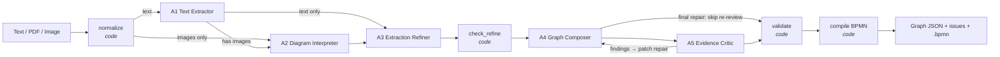

# Agent Orchestrator: AI Process Flow Diagramming Tool

The multi-agent backend from the FSD (`Process_Flow_Diagramming_FSD.docx`), cut down to hackathon size, plus a web frontend.
It turns SOP text, PDFs and legacy diagram images into an **evidence-cited swimlane graph** and a **BPMN file** that bpmn-js can open.

Stack: Node.js + TypeScript · **Next.js + shadcn/ui + Tailwind** (`client/`) · **bpmn-js** (diagram editor) · **Express.js** (`server/`) · **LangGraph.js** (orchestration) · **LangChain.js** (model calls) · zod (contracts) · Gemini, Qwen, Mistral, Kimi or Llama.

## The agents

| Agent | Job | Allowed to |
|---|---|---|
| **A1** Text Extractor | Pulls actors, steps, decisions and order from text | Extract claims only |
| **A2** Diagram Interpreter | Reads lanes, shapes and arrows from images and image-only PDF pages | Extract shapes only |
| **A3** Extraction Refiner *(our addition)* | Merges A1 + A2: unifies actor aliases, links the same step across text and diagram, tightens labels, flags implied order | Clean up claims; no new facts, nothing dropped silently |
| **A4** Graph Composer | Builds lanes, nodes, edges and notes from the refined claims | Change the graph |
| **A5** Evidence Critic | Checks the graph against the **original** evidence | Report findings only (read-only) |

> Numbering note: the FSD calls the composer "A3" and the critic "A4". We added the refiner, so here they are A4 and A5.



**Design points to explain in the pitch**
- **Bounded agents with fixed roles**, not an open-ended agent chat. LangGraph runs a fixed `StateGraph`, so behaviour is predictable and every step shows up in the trace.
- **Every claim cites evidence** (`E3` = a text block, `IMG1` = an image). Code rejects invented evidence IDs.
- **Table pages get a layout view.** PDF text extraction flattens table columns, so `normalize` flags pages with long runs of short lines and renders them (`P1`, `P2`, …, max 6). Only A1 sees them, to tell rows and columns apart; they are not evidence and are never cited.
- **Owners can come from a roles table.** If a step names no actor but a roles/responsibilities table assigns that work to one role, A1 uses that role, marks it `inferred` and raises `OWNER_INFERRED` (review), instead of parking the step in `Unassigned`.
- **Omissions are never `info`.** A5 marks a missing numbered step, approval, control or prohibition as `blocking`, and any other missing branch, exception path, loop or reopen route as at least `review`, so they trigger a repair.
- **Agents interpret; code decides.** Schema checks, the A3 "nothing dropped" guard, graph validation (start/end, reachability, decision branches, lanes) and BPMN generation are all deterministic code.
- **Critic → repair loop**, up to `MAX_REPAIRS` (2) repairs and a budget of `MAX_REQUESTS` (24) model calls per job. Repairs are cheap by design:
  - A4 returns a **patch** (upserts and removals, `A4Patch`), not a whole graph. Code applies it (`server/src/patch.ts`), and the prompt carries only the findings plus the evidence and refined claims they touch.
  - A5's **re-review** checks only the previous findings and the elements the patch changed, against their evidence. Info-only findings are carried forward in code.
  - The **final** repair is not re-reviewed (no further repair could follow it). Its targeted findings appear in Issues as "not re-checked".
  - **Structure errors join the loop.** After every A5 review, code runs the blocking graph checks (start/end events, lanes, dangling flows, duplicate IDs) and adds any failures as `STRUCT_*` findings, so A4 repairs them like critic findings. If a repair fixed only structure errors, the re-review is done in code with no model call.
  - **Drafts instead of nothing.** If blocking structure errors remain after the loop, the BPMN is still compiled as a draft (`result.draft: true`). Flows with missing ends and repeated IDs are left out and listed as `DRAFT_ELEMENTS_DROPPED`. The diagram page outlines the broken elements in red so the analyst can fix them in the editor and download the corrected `.bpmn`.
- **Copilot Chat fallback**: the same graph pauses with LangGraph `interrupt()`, an analyst pastes the prompt into Copilot Chat and pastes the JSON back, and the graph resumes. Replies are validated before the graph moves on.
- **Provider switch**: Gemini, Qwen, Mistral, Kimi or Llama, set per job.
- **Human stays in charge**: the output is a draft with an issue list. Nothing is ever "approved" by AI.

## Layout

```
agent-orchestrator/          npm workspaces root (one lockfile, one .gitignore)
├── server/                  Express + LangGraph API on :4000, CLI demo, fixtures
└── client/                  Next.js frontend on :3000
```

## Setup

Run everything from this folder (the workspace root).

```bash
npm install
cp server/.env.example server/.env          # add GOOGLE_API_KEY + GEMINI_MODEL (and/or the QWEN_*, MISTRAL_*, KIMI_*, LLAMA_* values)
cp client/.env.example client/.env.local    # NEXT_PUBLIC_API_URL, defaults to http://localhost:4000
npm run typecheck                           # both workspaces
npm run dev                                 # server on :4000 and client on :3000 together
```

Open http://localhost:3000. Chat mode works without any API key.

Set model IDs to exact models you have tested. A2 needs a model that can read images.

## Demo from the terminal

Run from the root (`npm run demo` runs inside `server/`, so paths are relative to `server/`):

```bash
npm run demo -- fixtures/tt-intake.txt                    # text → A1 → A3 → A4 → A5
npm run demo -- fixtures/account-opening.jpeg             # diagram → A2 → A3 → A4 → A5
npm run demo -- "../../TDP Capstone Process Flow Doc.pdf" # image-only PDF pages go to A2
npm run demo -- fixtures/tt-intake.txt --provider qwen
npm run demo -- fixtures/tt-intake.txt --mode chat        # Copilot Chat handoff, no API key needed
```

The CLI prints the agent trace, A3's changes, the graph by lane and the issues for review. It writes `server/out/<name>.result.json` and `server/out/<name>.bpmn`; drag the `.bpmn` file onto https://demo.bpmn.io to see the swimlanes.

In chat mode, each agent's prompt is written to `server/out/<name>.<role>.prompt.txt`. Paste it into a new Copilot Chat conversation, attach any page images it lists (written to `server/out/<name>.<n>_*.png`), save the reply to `server/out/<name>.<role>.response.json`, then press Enter.

## HTTP API (for the frontend)

`npm run dev -w server` starts only the server on `http://localhost:4000`, with CORS enabled.

| Method | Route | Body | Response |
|---|---|---|---|
| GET | `/health` | | `{ ok, provider }` |
| GET | `/v1/jobs` | | `{ runs: [{ id, title, sources, status, mode, provider, createdAt, updatedAt, issues, hasBpmn, archived }] }`, newest first |
| POST | `/v1/jobs` | multipart `files` (up to 10, 20 MiB each) and/or `text`, `mode` (`api`/`chat`), `provider` (`gemini`/`qwen`/`mistral`/`kimi`/`llama`) | `202 { jobId, status }` |
| GET | `/v1/jobs/:id` | | `{ status, mode, provider, progress: { next, repairCount, maxRepairs, requestCount, maxRequests }, trace, evidence, stages: {a1..a5}, pending, error, result }` (`next` is the graph node running, paused or failed now) |
| POST | `/v1/jobs/:id/resume` | `{ "response": "<JSON pasted from Copilot>" }` | `202`, or `422 CHAT_RESULT_INVALID` with field errors (the graph does not move on) |
| POST | `/v1/jobs/:id/mode` | `{ "mode": "chat" \| "api", "provider"?: ... }` | `202`; continues a failed or paused job on the other route and keeps finished agents |
| GET | `/v1/jobs/:id/attachments.zip` | | every image the pending prompt asks to attach, as one zip |
| GET | `/v1/jobs/:id/attachments/:imageId` | | PNG of an image the pending prompt asks to attach (e.g. a rendered PDF page), or `404 ATTACHMENT_NOT_FOUND`; live jobs only |
| GET | `/v1/jobs/:id/bpmn` | | BPMN XML file, or `409 BPMN_NOT_READY` |
| DELETE | `/v1/jobs/:id` | | `204`; removes the run from memory and history, or `409 RUN_BUSY` while it runs |

**Run history.** Every job's view is saved to `server/runs/<id>.json` (override with `RUNS_DIR`) each time it finishes, fails or pauses for chat, including CLI demo runs. After a restart, `GET /v1/jobs/:id` and `/bpmn` serve the saved copy with `archived: true`. A saved run can be viewed but not resumed or switched, because the LangGraph checkpoint is still in memory only. `server/runs/` is git-ignored because it holds excerpts of the source documents.

`status` is one of `running`, `awaiting_chat`, `done` or `failed`. Poll `GET /v1/jobs/:id` every 2 seconds.
When the status is `awaiting_chat`, show `pending.prompt` (with a copy button) and `pending.attachments`, then `POST /resume` with the pasted reply.
When the status is `done`, `result` contains `{ graph, issues, changes, bpmnXml, draft }` (`draft` is true when the BPMN still has blocking structure errors). Load `bpmnXml` into the bpmn-js Modeler.

Errors always look like `{ code, message, retryable, details? }`.

```bash
curl -X POST localhost:4000/v1/jobs -F files=@server/fixtures/tt-intake.txt -F mode=api
curl localhost:4000/v1/jobs/<jobId>
curl -X POST localhost:4000/v1/jobs/<jobId>/mode -H 'content-type: application/json' -d '{"mode":"chat"}'
curl -o out.bpmn localhost:4000/v1/jobs/<jobId>/bpmn
```

## Code map

| File | Purpose |
|---|---|
| `server/src/graph.ts` | LangGraph workflow: nodes, routing, repair loop, chat `interrupt()` |
| `server/src/patch.ts` | Applies A4 repair patches to the graph |
| `server/src/prompts.ts` | Shared rules plus A1–A5 role prompts, and the chat packet renderer |
| `server/src/schemas.ts` | zod contracts for every agent's output |
| `server/src/agents.ts` | Calls a model, validates its output, allows one format correction |
| `server/src/llm.ts` | LangChain adapters: ChatGoogleGenerativeAI (Gemini), ChatMistralAI (Mistral), ChatOpenAI (Qwen, Kimi, Llama) |
| `server/src/evidence.ts` | Splits input into citable evidence (text blocks, images, rendered PDF pages) |
| `server/src/validate.ts` | Deterministic checks: A3 guard and graph rules |
| `server/src/bpmn.ts` | Graph → BPMN 2.0 XML with lanes and layout |
| `server/src/jobs.ts` | In-memory jobs: start, resume, switch mode, run history |
| `server/src/runs.ts` | Saves and loads run snapshots in `server/runs/` |
| `server/src/server.ts` | Express API |
| `server/src/cli.ts` | Terminal demo |

## Frontend (`client/`)

Next.js 16 (App Router, `cacheComponents` on) with shadcn/ui (Base UI) and Tailwind v4. It talks to the server only through `NEXT_PUBLIC_API_URL`.

- **New job** (`/`): file drop built on the shadcn `attachment` component, optional pasted text, mode and provider, and a server health badge.
- **Previous runs** (`/runs`): every saved run with its sources, status, issue counts and start time. Open one, download its BPMN or delete it.
- **Job page** (`/jobs/[id]`): polls every 2 s while running and shows the A1–A5 stepper. It has a Copilot Chat panel (copy the prompt, download the page images to attach, paste the JSON, with inline `422` field errors) and switches between API and chat when a job fails or pauses. Tabs show Issues, Graph, Refiner changes, Evidence and Trace. **Open in BPMN** opens the diagram in a new browser tab.
- **Diagram page** (`/jobs/[id]/diagram`): the diagram full screen in the bpmn-js Modeler. Edit it, then download `.bpmn` or SVG, or reset it to the generated version; the page warns before you leave with edits you have not downloaded. A draft diagram shows its blocking errors above the canvas and outlines those elements in red.

| File | Purpose |
|---|---|
| `client/src/lib/api.ts` | Typed fetch wrapper; turns the error contract into `ApiError` |
| `client/src/lib/types.ts` | Hand-written copy of the server's response shapes (keep in sync with `server/src/jobs.ts` and `schemas.ts`) |
| `client/src/hooks/use-job.ts` | Polling hook |
| `client/src/components/bpmn-modeler.tsx` | bpmn-js Modeler wrapper (client-only, loaded with `next/dynamic`) |
| `client/src/components/job-workspace.tsx` | Job page body |
| `client/src/components/chat-handoff.tsx` | Copilot Chat paste-back panel |

## Not built (production roadmap from the FSD)
Postgres checkpoints and job queue (checkpoints are in memory, so a paused or failed job cannot be resumed after a restart; its saved snapshot can still be viewed), auth and roles, revisions and approval, rate limiting, OCR for scanned text, parallel A1/A2, circuit breakers, packet expiry and mode epochs.

`fixtures/tt-intake.txt` is synthetic. Only send real bank documents to external models once the sponsor has approved it (FSD decision O03).
